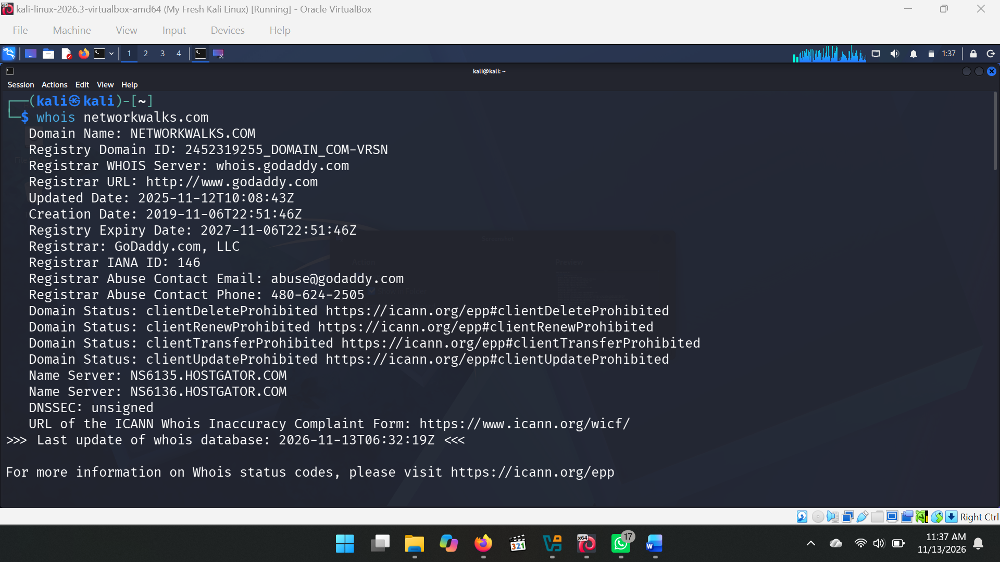

 <div align="center">

# WEEK 2 – PROJECT

## FOOTPRINTING & RECONNAISSANCE USING KALI LINUX

<p>
  
  
  
  
</p>

**A practical cybersecurity learning project focused on domain information gathering, DNS enumeration, HTTP header inspection, technology identification and Web Application Firewall detection using Kali Linux.**

</div>

---

## 📌 1. Project Overview

| Field | Details |
|---|---|
| Project Name | Week 2 – Footprinting & Reconnaissance |
| Author | Muhammad Talha |
| Platform | Kali Linux |
| Target Domain | `networkwalks.com` |
| Tools Used | WHOIS, nslookup, DNSRecon, curl, WhatWeb, wafw00f |
| Activity | Domain and Web Reconnaissance |
| Category | Cybersecurity / Ethical Hacking |

**Authorization and Scope:** All reconnaissance activities must be conducted only against domains and systems for which permission has been obtained. This project documents information-gathering exercises for educational purposes and does not constitute a vulnerability assessment or penetration test.

---

## 🎯 2. Project Objectives

The main objectives of this project are:

- Understand the fundamentals of footprinting and reconnaissance.
- Collect publicly available domain registration information.
- Identify DNS records and associated IP addresses.
- Inspect HTTP response headers.
- Identify technologies used by a target website.
- Detect the presence of a Web Application Firewall (WAF).
- Understand how reconnaissance information supports security assessments.
- Practise using common reconnaissance tools available in Kali Linux.

---

## 🛠️ 3. Tools Used

| Tool | Purpose |
|---|---|
| **WHOIS** | Retrieves domain registration and registrar information. |
| **nslookup** | Resolves domain names into IP addresses using DNS. |
| **DNSRecon** | Enumerates DNS records such as A, NS, MX, SOA, TXT and SRV. |
| **curl** | Inspects HTTP response headers and server responses. |
| **WhatWeb** | Identifies website technologies, CMS platforms and server details. |
| **wafw00f** | Detects the presence of Web Application Firewalls. |

---

## 💻 4. Practical Activities and Results

### Task 1 – Domain Information Gathering Using WHOIS

**Objective:** Collect publicly available domain registration information.

**Command used:**

```bash
whois networkwalks.com
```

**Purpose:**

WHOIS queries provide information about domain registration, registrar details, registration dates and name servers when those details are publicly available.

**Observations:**

- Retrieved publicly available domain registration information.
- Identified the domain registrar, if disclosed.
- Checked domain creation and expiration dates, if available.
- Examined registered name server information.
- Some registration details may be hidden because of privacy protection.

**Why this is useful:**

WHOIS helps understand domain ownership and registration-related information that may be useful during the initial reconnaissance phase.

**Screenshot / Evidence:**



---

### Task 2 – DNS Lookup Using nslookup

**Objective:** Resolve the target domain into its corresponding IP address.

**Command used:**

```bash
nslookup networkwalks.com
```

**Observations from the lab output:**

- DNS server used: `8.8.8.8`
- DNS server address: `8.8.8.8#53`
- Domain name: `networkwalks.com`
- Resolved IP address: `192.232.216.135`
- Response type: Non-authoritative answer.

**Why this is useful:**

DNS lookup helps identify the IP address associated with a domain and provides an initial understanding of its DNS resolution.

**Screenshot / Evidence:**


---

### Task 3 – DNS Enumeration Using DNSRecon

**Objective:** Identify DNS records associated with the target domain.

**Command used:**

```bash
dnsrecon -d networkwalks.com
```

**Observations from the lab output:**

- DNSRecon reported **8 records found**.
- SOA record: `ns6135.hostgator.com` – `50.87.144.87`
- Name servers:
  - `ns6136.hostgator.com` – `192.232.216.131`
  - `ns6135.hostgator.com` – `50.87.144.87`
- A record: `networkwalks.com` – `192.232.216.135`
- MX record: `mail.networkwalks.com` – `192.232.216.135`
- TXT records included Google site verification and SPF information.
- SRV records were identified for `_autodiscover._tcp.networkwalks.com`.
- No answer was reported for the DNSSEC query.

**Why this is useful:**

DNS enumeration helps understand domain infrastructure, identify mail servers and name servers, and discover publicly available DNS information.

**Screenshot / Evidence:**


---

### Task 4 – HTTP Header Inspection Using curl

**Objective:** Examine HTTP response headers returned by the target website.

**Command used:**

```bash
curl -I https://networkwalks.com
```

**Observations from the lab output:**

- HTTP response: `200 OK`
- Server: `Apache`
- Content type: `text/html; charset=UTF-8`
- The response included `Permissions-Policy` and `Referrer-Policy` headers.
- The `Link` header exposed WordPress REST API references, including `/wp-json/`.
- A cookie named `__wpdm_client` was observed with `Secure` and `HttpOnly` attributes.
- Cache-related headers included `X-Endurance-Cache-Level` and `X-nginx-cache`.

**Why this is useful:**

HTTP header inspection provides information about the web server, application behavior, security-related response headers and caching mechanisms.

**Screenshot / Evidence:**


---

### Task 5 – Website Technology Identification Using WhatWeb

**Objective:** Identify technologies and applications used by the target website.

**Command used:**

```bash
whatweb https://networkwalks.com
```

**Purpose:**

WhatWeb is a website fingerprinting tool that identifies technologies used by websites, including:

- Content Management Systems (CMS).
- Web server technologies.
- JavaScript libraries.
- Programming frameworks.
- Website plugins.
- Server and application technologies.

**Observations:**

- The tool was used to fingerprint the target website.
- Technology identification details should be recorded from the actual WhatWeb output.
- Any detected CMS, server technologies, plugins or frameworks should be documented based on the terminal results.

**Why this is useful:**

Technology fingerprinting helps security professionals understand the visible technology stack of a website and identify components that may require further security review.

**Screenshot / Evidence:**


---

### Task 6 – Web Application Firewall Detection Using wafw00f

**Objective:** Identify whether the target website is protected by a detectable Web Application Firewall.

**Command used:**

```bash
wafw00f networkwalks.com
```

**Observations from the lab output:**

- Detected Web Application Firewall: **ModSecurity (SpiderLabs)**.
- Number of requests reported: `2`.
- The detection check completed successfully.

**Why this is useful:**

WAF detection provides an initial indication of the security technology protecting a web application.

A detected WAF does not guarantee complete protection against all attacks. Its effectiveness depends on configuration, rules and maintenance.

**Screenshot / Evidence:**


---

## 📊 5. Summary of Results

| No. | Tool | Activity | Result |
|---|---|---|---|
| 1 | WHOIS | Domain information gathering | Retrieved publicly available registration information. |
| 2 | nslookup | DNS resolution | Resolved domain to `192.232.216.135`. |
| 3 | DNSRecon | DNS enumeration | Reported 8 DNS records. |
| 4 | curl | HTTP header inspection | Received `200 OK`; identified Apache and response headers. |
| 5 | WhatWeb | Technology fingerprinting | Used to identify website technologies; findings to be verified from screenshot. |
| 6 | wafw00f | WAF detection | Detected ModSecurity (SpiderLabs). |

---

## 🔍 6. Security Analysis and Observations

The reconnaissance activities provided an overview of the target domain's publicly observable infrastructure.

| Area | Observation | Security Relevance |
|---|---|---|
| Domain Registration | Public WHOIS information | May reveal registration and infrastructure details. |
| DNS Configuration | Multiple DNS record types identified | Helps understand domain and service configuration. |
| IP Resolution | Domain resolved to an IP address | Identifies the destination returned by the DNS resolver. |
| HTTP Headers | Apache and application-related headers observed | May reveal information about server and application technologies. |
| Technology Fingerprinting | WhatWeb used for identification | Helps understand the visible technology stack. |
| WAF Detection | ModSecurity identified | Indicates a detectable application protection layer. |

**Note:** Information gathered during reconnaissance is not proof of a security vulnerability. Further authorized testing would be required to assess actual security weaknesses.

---

## 🛡️ 7. Security Recommendations

Based on the reconnaissance concepts practised in this project, the following general security recommendations are relevant:

1. **Domain Privacy:** Avoid exposing unnecessary domain registration information.
2. **DNS Security:** Regularly review DNS records and remove outdated or unnecessary entries.
3. **HTTP Security Headers:** Configure appropriate security headers to improve browser-side protection.
4. **Server Security:** Keep web server software and application components updated.
5. **Technology Disclosure:** Avoid unnecessarily exposing detailed server and software version information.
6. **WAF Configuration:** Maintain and regularly review WAF rules and security policies.
7. **Regular Auditing:** Conduct authorized security assessments to identify configuration weaknesses.

---

## 🎓 8. Learning Outcomes

Through this practical project, I learned:

1. How to collect domain registration information using WHOIS.
2. How to resolve domain names using nslookup.
3. How to enumerate DNS records using DNSRecon.
4. How to inspect HTTP response headers using curl.
5. How to identify website technologies using WhatWeb.
6. How to detect Web Application Firewalls using wafw00f.
7. How to interpret reconnaissance results.
8. How to document cybersecurity practical activities with terminal screenshots.
9. How reconnaissance contributes to the initial stages of an ethical hacking assessment.

---

## 📝 9. Conclusion

I practised the fundamentals of footprinting and reconnaissance using Kali Linux.

During this project, I explored six reconnaissance tools: WHOIS, nslookup, DNSRecon, curl, WhatWeb and wafw00f.

These activities helped me understand how publicly observable information can reveal domain registration details, DNS configurations, HTTP response headers, website technologies and detectable security protection mechanisms.

This practical improved my understanding of information gathering, command-line tools and basic website reconnaissance.

The project focused on educational information gathering and did not involve exploitation or unauthorized access.

---

## 📂 10. Repository Structure

The repository contains the README documentation and all practical screenshots directly in the root directory.

```text
WEEK-2-FOOTPRINTING-RECONNAISSANCE/
│
├── README.md
├── whois-result.png
├── nslookup-result.png
├── dnsrecon-result.png
├── curl-result.png
├── whatweb-result.png
└── wafw00f-result.png
```

**Note:** All screenshots are uploaded directly to the main repository without creating a separate folder. Make sure the image filenames match the links used in this README.

---

## 👤 11. Author

**Muhammad Talha**

B.Tech Student | Cybersecurity Intern, NetworkWalks  
Batch: B084N

- **GitHub:** [Singari-Laharika](https://github.com/Singari-Laharika)
- **LinkedIn:** [Singari Laharika](https://www.linkedin.com/in/singari-laharika/)

---

## 📌 12. Project Information

| Field | Details |
|---|---|
| Program | Cybersecurity at NetworkWalks |
| Week | 02 |
| Project | Footprinting & Reconnaissance |
| Platform | Kali Linux |
| Repository | GitHub |
| Focus | Information Gathering |

---

<div align="center">

*Learning Cybersecurity One Practical at a Time.*

</div>
